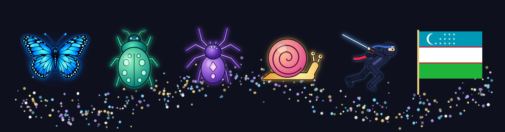

# Butterfly Cursor 🦋



**🇷🇺 Русский** · [🇬🇧 English](#-english) · [🇺🇿 Oʻzbekcha](#-oʻzbekcha)

---

## 🇷🇺 Русский

**Butterfly Cursor — программа просто для красоты.** Она не делает ничего полезного: по экрану за указателем мыши летает светящаяся бабочка и оставляет за собой волшебную пыльцу, как у феи. Когда мышь не двигается, бабочка улетает к кнопке «Пуск» и отдыхает там.

### Что умеет

- 🦋 Бабочка, жук, паук, улитка, **живая змея** (тело повторяет путь головы, она кружится, проползает по себе и сворачивается кольцом), лиса, слонёнок, **панда-мастер** (в покое ест бамбук), **ниндзя с мечом** (медитирует на «Пуске»), лучадор «Бабочка», **пиксельный коммандос** (прыгает кувырком), байкер, спасательный и **ударный вертолёты**, **рука-помощница** на пальцах, **облака с дождём и снегом, солнце и луна**, а также **флаг любой страны** (271 флаг).
- 🎨 Окно выбора существа с живым превью и категориями, светлая и тёмная тема.
- 🔄 Сама сообщает о новой версии и обновляется по кнопке «Да» (можно отключить).
- 🎬 **Демонстрация для видео**, искры и сюрикены по клику, снег/листья/сакура/тыквы/конфетти по сезону, танец под музыку, ночное свечение и пара секретов.
- ✨ Светящаяся пыльца: свои цвета (любой RGB), количество, размер, яркость, сияние вокруг существа.
- 🖼️ Свои картинки: JPG/PNG — фон убирается автоматически. Полоска кадров (PNG шириной в несколько квадратов) превращается в анимацию.
- 🎮 Не мешает: клики проходят сквозь неё, в играх и полноэкранном видео она прячется, а в рабочих программах (Photoshop, Zoom, Word…) — засыпает маленькой у «Пуска» или исчезает.
- 🖥️ Несколько мониторов, Windows 10 и 11 (кнопка «Пуск» по центру или слева).
- 🌐 Русский, английский и узбекский языки, встроенная инструкция.
- 📦 Установщик без прав администратора: выбор папки, ярлыки, удаление через «Параметры → Приложения».

### Установка

1. Скачайте `Butterfly.exe` со страницы [Releases](../../releases).
2. Запустите и нажмите «Установить» (или «Запустить без установки»).
3. Windows может показать «Система Windows защитила ваш компьютер» — программа не подписана. Нажмите «Подробнее» → «Выполнить в любом случае».

Настройки: значок бабочки возле часов или правый клик по рабочему столу → «Бабочка — настройки».

### Сборка из исходников

Нужен только Windows — компилятор C# из .NET Framework 4 уже есть в системе:

```bat
build.bat
```

Картинки существ рисуются скриптами Python из папки `tools` (нужны Pillow, NumPy, SciPy).

---

## 🇬🇧 English

**Butterfly Cursor is a program just for beauty.** It does nothing useful: a glowing butterfly follows your mouse pointer around the screen and leaves a trail of fairy dust. When the mouse is still, it flies to the Start button and rests there.

### Features

- 🦋 A butterfly, a beetle, a spider, a snail, a **live snake** (the body follows the head's path; it loops, crawls over itself and coils up), a fox, a baby elephant, a **panda master** (eats bamboo when idle), a **ninja with a sword** (meditates on the Start button), the luchador “Mariposa”, a **pixel commando** (somersaults), a biker, a rescue and an **attack helicopter**, a **helper hand** walking on its fingers, **rain and snow clouds, the sun and the moon**, and **any country's flag** (271 flags).
- 🎨 A creature picker with a live preview and categories, light and dark theme.
- 🔄 Tells you about a new version and updates itself when you press “Yes” (can be switched off).
- 🎬 **Demo mode for videos**, sparks and shurikens on click, seasonal snow / leaves / sakura / pumpkins / confetti, dancing to music, night glow and a couple of secrets.
- ✨ Glowing dust: your own colours (any RGB), amount, size, brightness, a glow around the creature.
- 🖼️ Your own pictures: JPG/PNG with the background removed automatically. A strip of square frames becomes an animation.
- 🎮 Never in the way: clicks pass through it, it hides during games and full-screen video, and in work programs (Photoshop, Zoom, Word…) it dozes, small, by the Start button or disappears.
- 🖥️ Multiple monitors, Windows 10 and 11 (Start button centred or on the left).
- 🌐 Russian, English and Uzbek, with built-in help.
- 📦 Installer without admin rights: choose a folder, shortcuts, uninstall from Settings → Apps.

### Install

1. Download `Butterfly.exe` from [Releases](../../releases).
2. Run it and press “Install” (or “Run without installing”).
3. Windows may say “Windows protected your PC” because the program is not signed: click “More info” → “Run anyway”.

Settings: the butterfly icon near the clock, or right-click the desktop → “Butterfly — settings”.

### Building

Only Windows is needed — the C# compiler of .NET Framework 4 is already part of it:

```bat
build.bat
```

The creature pictures are drawn by the Python scripts in `tools` (Pillow, NumPy, SciPy).

---

## 🇺🇿 Oʻzbekcha

**Butterfly Cursor — shunchaki goʻzallik uchun dastur.** U hech qanday foydali ish qilmaydi: ekranda sichqoncha koʻrsatkichi ortidan yaltiroq kapalak uchib yuradi va ortidan sehrli chang qoldiradi. Sichqoncha qimirlamasa, kapalak «Pusk» tugmasi yoniga uchib borib, dam oladi.

### Imkoniyatlari

- 🦋 Kapalak, qoʻngʻiz, oʻrgimchak, shilliqqurt, **jonli ilon** (tanasi boshining yoʻlidan yuradi, aylanadi, oʻz ustidan oʻtadi va halqa boʻlib oʻraladi), tulki, fil bolasi, **panda usta** (dam olganda bambuk yeydi), **qilichli ninja** («Pusk» ustida meditatsiya qiladi), «Kapalak» luchadori, **piksel komandos** (umbaloq oshib sakraydi), bayker, qutqaruv va **hujumchi vertolyotlar**, barmoqlarida yuradigan **yordamchi qoʻl**, **yomgʻirli va qorli bulutlar, quyosh va oy**, hamda **istalgan davlat bayrogʻi** (271 ta bayroq).
- 🎨 Jonli koʻrinishli va toifali jonzot tanlash oynasi, yorugʻ va qorongʻi mavzu.
- 🔄 Yangi versiya chiqqanini oʻzi aytadi va «Ha» tugmasi bilan yangilanadi (oʻchirib qoʻyish mumkin).
- 🎬 **Video uchun namoyish**, bosganda uchqun va shurikenlar, mavsumiy qor / barglar / sakura / qovoqlar / konfetti, musiqaga raqs, tungi yogʻdu va bir nechta sir.
- ✨ Yaltiroq chang: oʻz ranglaringiz (istalgan RGB), soni, oʻlchami, yorqinligi, jonzot atrofidagi yogʻdu.
- 🖼️ Oʻz rasmlaringiz: JPG/PNG — fon avtomatik olib tashlanadi. Kvadrat kadrlardan iborat tasma animatsiyaga aylanadi.
- 🎮 Xalaqit bermaydi: bosishlar undan oʻtib ketadi, oʻyin va toʻliq ekranli videoda yashirinadi, ish dasturlarida (Photoshop, Zoom, Word…) esa «Pusk» yonida kichrayib uxlaydi yoki gʻoyib boʻladi.
- 🖥️ Bir nechta monitor, Windows 10 va 11.
- 🌐 Rus, ingliz va oʻzbek tillari, ichki qoʻllanma.
- 📦 Administrator huquqisiz oʻrnatuvchi: papka tanlash, yorliqlar, «Sozlamalar → Ilovalar» orqali oʻchirish.

### Oʻrnatish

1. `Butterfly.exe` faylini [Releases](../../releases) sahifasidan yuklab oling.
2. Ishga tushiring va «Oʻrnatish» tugmasini bosing (yoki «Oʻrnatmasdan ishga tushirish»).
3. Windows «Windows kompyuteringizni himoya qildi» deb koʻrsatishi mumkin — dastur imzolanmagan. «Batafsil» → «Baribir ishga tushirish» ni bosing.

---

## Licence / Лицензия / Litsenziya

[MIT](LICENSE). Country flags: [flag-icons](https://github.com/lipis/flag-icons) by Panayiotis Lipiridis, MIT — see [THIRD-PARTY-NOTICES.md](THIRD-PARTY-NOTICES.md).
