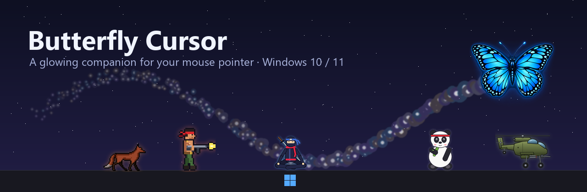
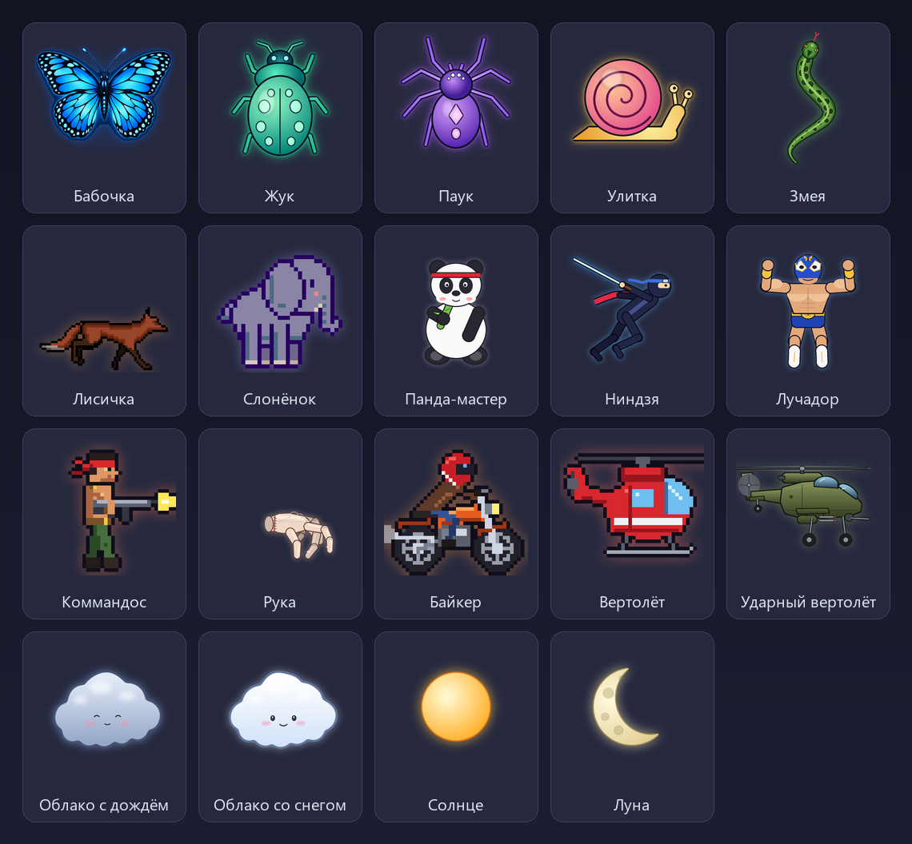
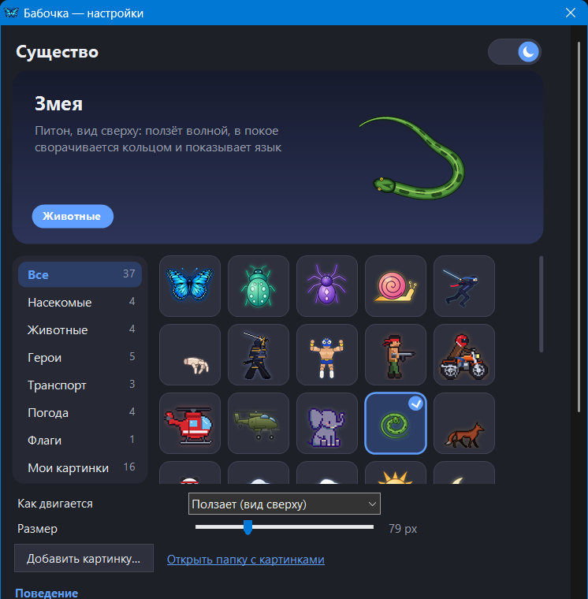
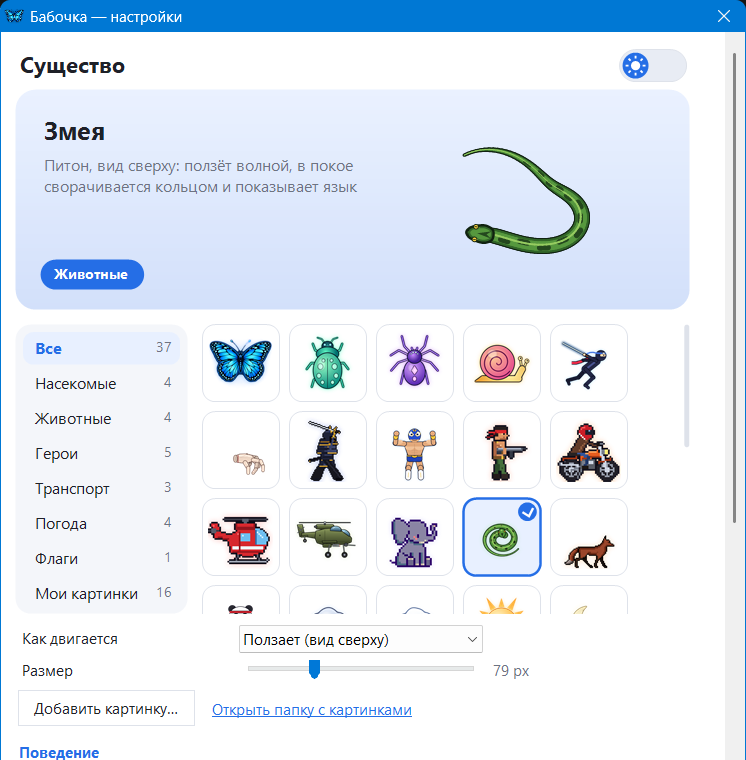

<div align="center">



[](../../releases/latest)
[](../../releases)

[](LICENSE)

### [⬇️ Скачать Butterfly.exe / Download](../../releases/latest/download/Butterfly.exe)

**🇷🇺 [Русский](#-русский)** · **🇬🇧 [English](#-english)** · **🇺🇿 [Oʻzbekcha](#-oʻzbekcha)**

</div>

---

## 🇷🇺 Русский

**Butterfly Cursor — программа просто для красоты.** За указателем мыши летает светящаяся бабочка (или змея, ниндзя, вертолёт — выбирайте) и оставляет за собой волшебную пыльцу, как у феи. Когда мышь не двигается, она улетает к кнопке «Пуск» и отдыхает там: ниндзя медитирует, панда ест бамбук, змея сворачивается кольцом.

Один файл, 3,5 МБ, без прав администратора. Бесплатно и с открытым кодом.

### ✨ Что умеет

| | |
|---|---|
| 🦋 **19 существ** | бабочка, жук, паук, улитка, живая змея, лиса, слонёнок, панда-мастер, ниндзя, лучадор, пиксельный коммандос, байкер, спасательный и ударный вертолёты, рука-помощница, облака, солнце, луна и **флаг любой страны** (271 флаг) |
| 🐍 **Живые движения** | у каждого своя скорость и плавный разгон; змея ползёт волной и проползает по себе, вертолёт наклоняется в полёте, коммандос прыгает кувырком |
| 🌟 **Пыльца** | любые цвета (RGB), количество, размер, яркость, сияние вокруг существа, радужный режим |
| 🖼️ **Свои картинки** | любой JPG/PNG — фон убирается автоматически; полоска кадров превращается в анимацию |
| 🎮 **Не мешает** | клики проходят насквозь; в играх и полноэкранном видео прячется; в рабочих программах (Photoshop, Zoom, Word…) засыпает маленькой у «Пуска» |
| 🎉 **Развлечения** | снег, листья, сакура и тыквы по сезону, искры по клику, танец под музыку, ночное свечение, режим для видео и пара секретов |
| 🚀 **Автозагрузка** | запускается вместе с Windows (галочка в настройках, включается при установке) |
| 🔄 **Обновления** | сама сообщает о новой версии: «Да» — обновляется сразу, «Нет» — спросит через 12 часов |
| 🎨 **Удобные настройки** | окно выбора с живым превью и категориями, светлая и тёмная тема, русский, английский и узбекский языки |
| 🖥️ **Где работает** | Windows 10 и 11, несколько мониторов, «Пуск» по центру или слева |
| 🪶 **Лёгкая** | около 35 МБ памяти и несколько процентов одного ядра процессора |

### 🖼️ Существа



### ⚙️ Настройки

| Тёмная тема | Светлая тема |
|:---:|:---:|
|  |  |

Настройки открываются щелчком по значку бабочки возле часов или правым кликом по рабочему столу → «Бабочка — настройки».

### 📥 Установка

1. Скачайте [`Butterfly.exe`](../../releases/latest/download/Butterfly.exe).
2. Запустите и нажмите «Установить» (или «Запустить без установки»).
3. Windows может показать «Система Windows защитила ваш компьютер» — программа не подписана платным сертификатом. Нажмите «Подробнее» → «Выполнить в любом случае».

### ❓ Частые вопросы

<details><summary><b>Есть ли автозагрузка?</b></summary>

Да. При установке программа добавляется в автозагрузку. Отключить или включить: настройки → «Запускать вместе с Windows». Запись хранится в обычном месте — `HKCU\Software\Microsoft\Windows\CurrentVersion\Run`.
</details>

<details><summary><b>Не будет мешать в играх?</b></summary>

Нет. В полноэкранных играх и видео существо прячется само, а клики всегда проходят сквозь него. Для рабочих программ есть список: там существо засыпает маленьким у «Пуска» или исчезает совсем.
</details>

<details><summary><b>Как удалить?</b></summary>

«Параметры → Приложения → Butterfly Cursor → Удалить». Программа убирает за собой всё: файлы, ярлыки, автозагрузку и пункт в меню рабочего стола.
</details>

<details><summary><b>Как обновлять?</b></summary>

Никак — программа сама раз в 12 часов проверяет, нет ли новой версии, и спрашивает «Обновиться?». Проверить вручную: значок у часов → «Проверить обновления». Отключить: настройки → «Сообщать о новых версиях».
</details>

<details><summary><b>Программа собирает какие-нибудь данные?</b></summary>

Нет. Единственное обращение в интернет — к GitHub, чтобы узнать номер последней версии. Никаких аккаунтов, рекламы и телеметрии. Код открыт — можно проверить.
</details>

<details><summary><b>А для Linux и macOS?</b></summary>

Пока только Windows: программа использует особые окна Windows и знает, где кнопка «Пуск». Версии для других систем — в планах.
</details>

### 🛠️ Сборка из исходников

Нужен только Windows — компилятор C# из .NET Framework 4 уже есть в системе:

```bat
build.bat
```

Картинки существ рисуются скриптами Python из папки `tools` (Pillow, NumPy, SciPy).

---

## 🇬🇧 English

**Butterfly Cursor is a program just for beauty.** A glowing butterfly (or a snake, a ninja, a helicopter — your choice) follows your mouse pointer and leaves a trail of fairy dust. When the mouse is still, it flies to the Start button and rests there: the ninja meditates, the panda eats bamboo, the snake coils up.

One 3.5 MB file, no admin rights, free and open source.

### ✨ Features

- 🦋 **19 creatures** — butterfly, beetle, spider, snail, a live snake, fox, baby elephant, panda master, ninja, luchador, pixel commando, biker, rescue and attack helicopters, helper hand, clouds, sun, moon and **any country's flag** (271 flags).
- 🐍 **Lifelike motion** — each has its own speed and smooth acceleration; the snake slithers and crawls over itself, helicopters dip their nose, the commando somersaults.
- 🌟 **Glowing dust** — any RGB colours, amount, size, brightness, a glow around the creature, rainbow mode.
- 🖼️ **Your own pictures** — any JPG/PNG with the background removed automatically; a strip of frames becomes an animation.
- 🎮 **Never in the way** — clicks pass through; hides in games and full-screen video; dozes small by Start in work apps (Photoshop, Zoom, Word…).
- 🎉 **Fun** — seasonal snow, leaves, sakura and pumpkins, sparks on click, dancing to music, night glow, a demo mode for videos and a couple of secrets.
- 🚀 **Starts with Windows** — a checkbox in the settings, switched on by the installer.
- 🔄 **Updates itself** — “Yes” updates right away, “No” asks again in 12 hours.
- 🎨 **Settings** — a creature picker with a live preview, light and dark theme, Russian, English and Uzbek.
- 🖥️ Windows 10 and 11, multiple monitors · 🪶 about 35 MB of memory.


### 📥 Install

1. Download [`Butterfly.exe`](../../releases/latest/download/Butterfly.exe).
2. Run it and press “Install” (or “Run without installing”).
3. If Windows says “Windows protected your PC” (the program is not signed): “More info” → “Run anyway”.

### ❓ FAQ

- **Autostart?** Yes — set by the installer; toggle it in the settings (“Start with Windows”). It is the usual `HKCU\…\CurrentVersion\Run` entry.
- **Games?** It hides in full-screen games and video; clicks always pass through.
- **Uninstall?** Settings → Apps → Butterfly Cursor → Uninstall. Everything is removed.
- **Data?** None collected. The only network request asks GitHub for the latest version number.
- **Linux / macOS?** Windows only for now; other systems are planned.

### 🛠️ Building

```bat
build.bat
```

Only Windows is needed (the C# compiler of .NET Framework 4). Creature pictures are drawn by the Python scripts in `tools`.

---

## 🇺🇿 Oʻzbekcha

**Butterfly Cursor — shunchaki goʻzallik uchun dastur.** Sichqoncha koʻrsatkichi ortidan yaltiroq kapalak (yoki ilon, ninja, vertolyot — tanlang) uchib yuradi va sehrli chang qoldiradi. Sichqoncha qimirlamasa, «Pusk» tugmasi yoniga borib dam oladi.

- 🦋 **19 ta jonzot** va **istalgan davlat bayrogʻi** (271 ta).
- 🐍 Har birining oʻz tezligi va ravon tezlanishi; ilon toʻlqinsimon sudraladi, vertolyot uchayotganda egiladi.
- 🌟 Yaltiroq chang: istalgan RGB rang, soni, oʻlchami, yorqinligi.
- 🖼️ Oʻz rasmlaringiz: JPG/PNG — fon avtomatik olib tashlanadi.
- 🎮 Xalaqit bermaydi: oʻyin va toʻliq ekranli videoda yashirinadi.
- 🚀 **Windows bilan birga ishga tushadi** (sozlamalarda belgicha).
- 🔄 Yangi versiya haqida oʻzi aytadi va «Ha» bilan yangilanadi.
- 🎨 Jonli koʻrinishli tanlash oynasi, yorugʻ va qorongʻi mavzu, rus, ingliz va oʻzbek tillari.

**Oʻrnatish:** [`Butterfly.exe`](../../releases/latest/download/Butterfly.exe) ni yuklab oling, ishga tushiring va «Oʻrnatish» ni bosing. Windows ogohlantirsa: «Batafsil» → «Baribir ishga tushirish».

---

## Licence / Лицензия / Litsenziya

[MIT](LICENSE) · Author: **JB**. Country flags: [flag-icons](https://github.com/lipis/flag-icons) (MIT); pixel fox and elephant base: CC0 sprites by ScratchIO and zonked — see [THIRD-PARTY-NOTICES.md](THIRD-PARTY-NOTICES.md).
